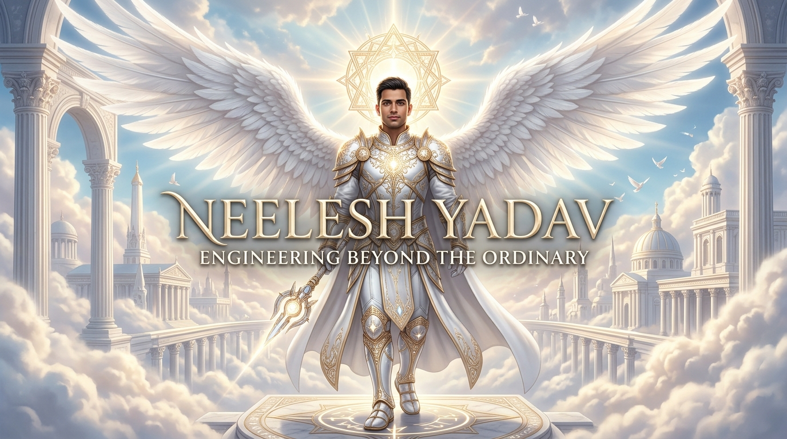

<div align="center">



<br><br>


# ✧ &nbsp; NEELESH YADAV &nbsp; ✧

<p align="center">
  <a href="https://github.com/neelesh1097">
    
  </a>
</p>

<p align="center">
  
  
  
  
</p>

<p align="center">
  <a href="https://porfolio-eta-lilac.vercel.app/" target="_blank">
    
  </a>
  &nbsp;
  <a href="https://www.linkedin.com/in/neelesh-yadav-a5988b292/" target="_blank">
    
  </a>
  &nbsp;
  <a href="https://github.com/neelesh1097?tab=repositories" target="_blank">
    
  </a>
  &nbsp;
  <a href="https://komarev.com/ghpvc/?username=neelesh1097&color=D6BD86&style=for-the-badge&label=SANCTUARY%20VISITORS" target="_blank">
    
  </a>
</p>

<br>


</div>

<br>

## ✦ &nbsp; I. THE ARCHITECTURE OF INTENT


I am a **Software Engineer** dedicated to building web systems of enduring quality, resilient backend architecture, and seamless digital experiences. I approach software engineering as modern digital cathedral-building: sculptured from mathematical logic, engineered for enduring permanence, and elevated through immaculate architectural discipline.

Moving beyond isolated feature delivery, my engineering focus centers on **scalable system design, relational and document data modeling, API reliability, and asymptotic performance optimization**. I treat code as a craft—balancing developer ergonomics with runtime efficiency, enforcing strict type safety from database to client, and creating modular codebases built to adapt and scale.

### ⚜️ Core Engineering Pillars

- ◈ **Distributed & Backend Architecture:** Designing high-concurrency RESTful APIs, transactional state workflows, authentication mechanisms (JWT/OAuth), and optimized database pipelines.
- ◈ **Modern Frontend Architecture:** Building declarative, sub-second web applications leveraging Next.js (App Router), React, Redux Toolkit, and atomic component hierarchies.
- ◈ **Algorithmic Rigor & Data Structures:** Solid foundation in Java and TypeScript problem solving, analyzing time and space complexities ($O(1)$, $O(\log n)$, $O(n)$) to prevent architectural bottlenecks.
- ◈ **DevOps & Infrastructure:** Containerized workflows with Docker, automated CI/CD deployment pipelines (Vercel, Render), clean separation of environments, and defensive error handling.

<br clear="right">

> *"Software at the highest echelon is not mere instruction; it is architecture sculpted from logic, enduring as marble, luminous as light."*

<div align="center">
  
</div>

<br>

## ✦ &nbsp; II. THE PILLARS OF MASTERY

| Architectural Domain | Core Specialization | Engineering Standards & Methodologies |
| :--- | :--- | :--- |
| **Backend & Distributed Systems** | Scalable RESTful Services, MVC / Service-Repository Layers | Defensive Input Validation, Rate Limiting, Error Middleware, Connection Pooling |
| **Data Architecture & Schemas** | MongoDB, Mongoose, Relational & Document Modeling | Compound Indexing, Aggregation Frameworks, Atomic Updates, Query Optimization |
| **Frontend Systems & DX** | Next.js (App Router), React, Declarative State Management | Edge Rendering, SSR, Component Modularization, Strict Responsive UX |
| **Algorithmic Foundation** | Data Structures & Algorithms, Object-Oriented Design (Java) | Asymptotic Complexity Analysis, SOLID Principles, Clean Abstractions |
| **DevOps & Infrastructure** | Containerization, Cloud Deployment, Version Control | Docker Containers, Git Feature Branching, Automated CI/CD, Postman API Testing |

<br>

<div align="center">
  
</div>

<br>

## ✦ &nbsp; III. TECHNICAL ARSENAL

<table width="100%">
  <tr>
    <td width="30%"><strong>Languages & Runtime</strong></td>
    <td>
      
      <br>
      <code>TypeScript</code> · <code>JavaScript (ESNext)</code> · <code>Java (Core & DSA)</code> · <code>Node.js</code>
    </td>
  </tr>
  <tr>
    <td><strong>Backend & Data Systems</strong></td>
    <td>
      
      <br>
      <code>Express.js</code> · <code>REST APIs</code> · <code>MongoDB</code> · <code>Mongoose ORM</code> · <code>JWT Authentication</code>
    </td>
  </tr>
  <tr>
    <td><strong>Frontend & UI Systems</strong></td>
    <td>
      
      <br>
      <code>Next.js (App Router)</code> · <code>React.js</code> · <code>Redux Toolkit</code> · <code>Tailwind CSS</code>
    </td>
  </tr>
  <tr>
    <td><strong>DevOps, Cloud & Tooling</strong></td>
    <td>
      
      <br>
      <code>Docker</code> · <code>Git & GitHub Actions</code> · <code>Vercel</code> · <code>Render</code> · <code>Linux / Bash</code>
    </td>
  </tr>
</table>

<br>

<div align="center">
  
</div>

<br>

## ✦ &nbsp; IV. MONUMENTAL CREATIONS

### 01 · Full-Stack E-Commerce Engine & Order Platform
> *An end-to-end distributed commerce application built with full data persistence, secure authorization, product aggregation pipelines, and atomic cart operations.*

- **Architecture:** Decoupled client-server architecture with RESTful endpoints, role-based JWT auth, and protected middleware layers.
- **Key Capabilities:** Dynamic catalog filtering, MongoDB aggregation pipelines, persistent cart lifecycle, and cloud deployment.
- **Technologies:** `React` · `Node.js` · `Express.js` · `MongoDB` · `Render`
- **Access:** **[Live Deployment →](https://full-stack-1-x802.onrender.com/)** &nbsp;•&nbsp; **[Source Code Vault →](https://github.com/neelesh1097/full-stack)**

<br>

### 02 · High-Throughput URL Shortener & Redirect Service
> *A scalable backend service designed for high read-to-write ratios, rapid key-hashing redirection, and request analytics logging.*

- **Architecture:** Collision-resistant key generation algorithms, parameterized route handling, and database indexing for sub-millisecond query lookups.
- **Key Capabilities:** Click telemetry, TTL expiration, parameterized redirection, and clean input sanitization.
- **Technologies:** `Node.js` · `Express.js` · `MongoDB` · `REST API`
- **Access:** **[Source Code Vault →](https://github.com/neelesh1097/urlshortner)**

<br>

### 03 · Concurrent Ticket Reservation Engine
> *A reservation workflow system engineered with state-machine patterns to model seat availability and prevent race-condition overbooking.*

- **Architecture:** Strict transactional status transitions (`Reserved` → `Held` → `Confirmed` / `Expired`) with synchronized API contracts.
- **Key Capabilities:** Conflict resolution, inventory reservation holds, and modular service-layer separation.
- **Technologies:** `TypeScript` · `Node.js` · `Express.js` · `REST APIs`
- **Access:** **[Source Code Vault →](https://github.com/neelesh1097/ticket)**

<br>

### 04 · Modern Developer Portfolio & Digital Showcase
> *High-performance digital portfolio engineered with Next.js 14 App Router, dynamic typography, and automated edge deployment.*

- **Architecture:** Edge-rendered static-site generation (SSG) with optimized Lighthouse scores and strict TypeScript type boundaries.
- **Key Capabilities:** Responsive micro-interactions, dark-mode design system, and seamless CDN asset caching.
- **Technologies:** `Next.js` · `TypeScript` · `Tailwind CSS` · `Vercel`
- **Access:** **[Live Deployment →](https://porfolio-eta-lilac.vercel.app/)** &nbsp;•&nbsp; **[Source Code Vault →](https://github.com/neelesh1097/porfolio)**

<br>

<div align="center">
  
</div>

<br>

## ✦ &nbsp; V. THE CODEX OF REPOSITORIES

| Project | Engineering Scope | Core Technologies | Repository |
| :--- | :--- | :--- | :---: |
| **Food Delivery Engine** | Multi-role platform: consumer cart, vendor order dispatch, real-time status | `React` · `Node.js` · `Express` · `MongoDB` | [Inspect Code →](https://github.com/neelesh1097/food-delivery) |
| **Finance Tracker** | Ledger management, multi-account expense categorization & balance calculations | `JavaScript` · `React` · `Tailwind CSS` | [Inspect Code →](https://github.com/neelesh1097/finance-tracker) |
| **Social Network Platform** | Feed aggregation, user relationships, post interactions & secure authentication | `React` · `Node.js` · `Express` · `MongoDB` | [Inspect Code →](https://github.com/neelesh1097/social-media) |
| **Crypto Market Analytics** | Real-time market data ingestion, API rate-handling & interactive financial charts | `React` · `CoinGecko REST API` · `Tailwind CSS` | [Inspect Code →](https://github.com/neelesh1097/crypto) |
| **Java DSA & Algorithms** | Algorithmic problem solving: Trees, Graphs, DP, Sorting & Space/Time optimization | `Java` · `Data Structures` · `Algorithms` | [Inspect Code →](https://github.com/neelesh1097/Java-prep) |
| **Backend Revision Vault** | Architecture notes, design patterns, microservices concepts & API security | `Node.js` · `Express` · `System Design` | [Inspect Code →](https://github.com/neelesh1097/Backend-revision) |

<br>

<div align="center">
  
</div>

<br>

## ✦ &nbsp; VI. CELESTIAL HORIZONS & TRAJECTORY

```text
DIVINE UPSKILLING & ARCHITECTURAL FOCUS
├── 01. Distributed Systems     ──> Message Queues (Kafka / RabbitMQ), In-Memory Caching (Redis), Eventual Consistency
├── 02. Advanced System Design  ──> Sharding, Read-Replicas, CAP Theorem trade-offs, Rate Limiting (Token Bucket)
├── 03. Algorithmic Mastery     ──> Advanced Graph Algorithms, Dynamic Programming, Heap/Trie Structures in Java
└── 04. Cloud & DevOps Pipeline ──> Docker Multi-stage Builds, CI/CD Pipeline Automation, Observability & Telemetry
```

<br>

<div align="center">
  
</div>

<br>

## ✦ &nbsp; VII. THE CELESTIAL CODEX

```text
┌─────────────────────────────────────────────────────────────────────────────────────────────┐
│                                 THE DIVINE ENGINEERING CODEX                                │
├─────────────────────────────────────────────────────────────────────────────────────────────┤
│  ✧ I.  ABSTRACTION HYGIENE  →  Never abstract prematurely; duplication is cheaper than the   │
│                                wrong abstraction. Clarity is the highest virtue of logic.   │
│                                                                                             │
│  ✧ II. MEASURED HARMONY     →  Measure before optimizing. Know your algorithmic bounds,     │
│                                indexing topologies, and cache invalidation mechanics.       │
│                                                                                             │
│  ✧ III. ARCHITECTURAL TRUTH →  Validate at every boundary. Make illegal states unrepresentable│
│                                through strict types and immutable data contracts.           │
│                                                                                             │
│  ✧ IV. ETERNAL STEWARDSHIP  →  True engineering ownership extends from the initial diagram  │
│                                to the final second of high-concurrency production uptime.   │
└─────────────────────────────────────────────────────────────────────────────────────────────┘
```

<br>

<div align="center">
  
</div>

<br>

## ✦ &nbsp; VIII. ESTABLISH ALLIANCE

Whether you are exploring **distributed system architecture, backend scalability, full-stack development, or high-impact software engineering opportunities**, the sanctuary is always open.

<p align="left">
  <a href="https://www.linkedin.com/in/neelesh-yadav-a5988b292/" target="_blank">
    
  </a>
  &nbsp;
  <a href="https://porfolio-eta-lilac.vercel.app/" target="_blank">
    
  </a>
  &nbsp;
  <a href="https://github.com/neelesh1097" target="_blank">
    
  </a>
</p>

<br>

<div align="center">
  
  <br>
  <sub>Divinely engineered by <strong>Neelesh Yadav</strong> · Crafted with architectural discipline & celestial precision · <em>Ad Astra Per Aspera</em></sub>
</div>
