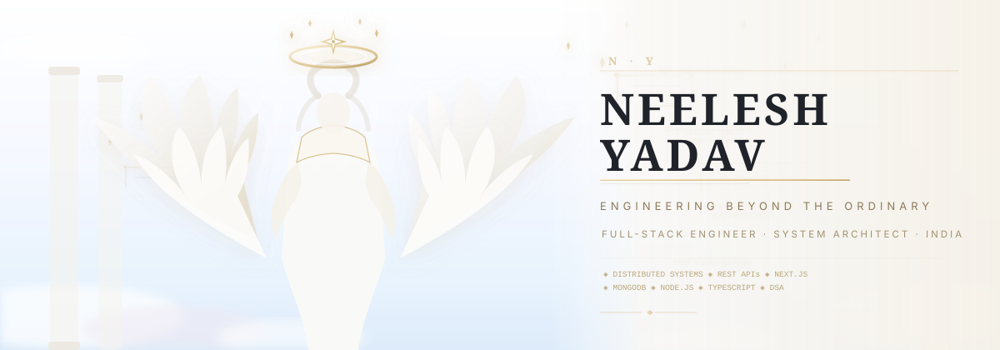

<!-- ═══════════════════════════════════════════════════════════
     DIVINE ENGINEERING — NEELESH YADAV — GITHUB PROFILE
     Celestial Light Identity · White · Ivory · Champagne Gold
     ═══════════════════════════════════════════════════════════ -->

<div align="center">

<!-- ✦ HERO BANNER ✦ -->


<br><br>

<!-- ✦ NY SEAL ✦ -->


<br>

# NEELESH YADAV


<br>

<!-- ✦ IDENTITY BADGES — Light Celestial Palette ✦ -->

&nbsp;

&nbsp;

&nbsp;


<br><br>

<!-- ✦ ACTION LINKS — Champagne / Ivory Palette ✦ -->
<a href="https://porfolio-eta-lilac.vercel.app/" target="_blank">
  
</a>
&nbsp;
<a href="https://www.linkedin.com/in/neelesh-yadav-a5988b292/" target="_blank">
  
</a>
&nbsp;
<a href="https://github.com/neelesh1097?tab=repositories" target="_blank">
  
</a>
&nbsp;
<a href="https://komarev.com/ghpvc/?username=neelesh1097" target="_blank">
  
</a>

<br><br>


</div>

<br>

---

## &nbsp; ✦ &nbsp; I &nbsp;·&nbsp; The Architecture of Intent


I am a **Software Engineer** dedicated to building web systems of enduring quality, resilient backend architecture, and seamless digital experiences. I approach engineering as modern cathedral-building: sculpted from mathematical logic, elevated through architectural discipline, and built to endure.

My focus has evolved beyond feature delivery toward **system design, data modeling, API reliability, and performance engineering**. I write code as a craft — balancing developer ergonomics with runtime efficiency, enforcing strict type safety from database to client.

<br>

**Core Engineering Pillars:**

◈ &nbsp;**Backend & Distributed Architecture** — High-concurrency RESTful APIs, transactional state workflows, JWT/OAuth, optimized database pipelines  
◈ &nbsp;**Frontend Architecture** — Next.js App Router, React, Redux Toolkit, atomic component hierarchies, sub-second rendering  
◈ &nbsp;**Algorithmic Rigor** — Java & TypeScript DSA, time/space complexity analysis, preventing architectural bottlenecks  
◈ &nbsp;**DevOps & Infrastructure** — Docker, automated CI/CD (Vercel, Render), environment separation, error resilience

<br clear="right">

> *"Software at the highest echelon is not mere instruction — it is architecture sculpted from logic, enduring as marble, luminous as light."*

<div align="center">
  
</div>

<br>

---

## &nbsp; ✦ &nbsp; II &nbsp;·&nbsp; Pillars of Mastery

| &nbsp;Domain | &nbsp;Core Specialization | &nbsp;Standards & Methodologies |
| :--- | :--- | :--- |
| **Backend & APIs** | Scalable RESTful Services, MVC / Service-Repository Architecture | Input Validation, Rate Limiting, Error Middleware, Connection Pooling |
| **Data Architecture** | MongoDB, Mongoose, Document & Relational Schema Design | Compound Indexing, Aggregation Frameworks, Atomic Updates, Query Optimization |
| **Frontend Systems** | Next.js 14 App Router, React, Declarative State Management | Edge Rendering, SSR, Component Modularization, Responsive UX |
| **Algorithmic Foundation** | Data Structures & Algorithms, Object-Oriented Design (Java) | Asymptotic Complexity, SOLID Principles, Clean Abstractions |
| **DevOps & Cloud** | Containerization, Cloud Deployment, Version Control | Docker, Git Branching, Automated CI/CD, Postman API Testing |

<div align="center">
  
</div>

<br>

---

## &nbsp; ✦ &nbsp; III &nbsp;·&nbsp; Technical Arsenal

<div align="center">

**Languages & Runtimes**


**Backend & Data**


**Frontend & UI**


**DevOps & Cloud**


</div>

<br>

<table width="100%">
  <tr>
    <td width="30%" valign="top"><strong>Languages</strong></td>
    <td><code>TypeScript</code> &nbsp;·&nbsp; <code>JavaScript (ESNext)</code> &nbsp;·&nbsp; <code>Java (Core + DSA)</code> &nbsp;·&nbsp; <code>Node.js</code></td>
  </tr>
  <tr>
    <td valign="top"><strong>Backend & Data</strong></td>
    <td><code>Express.js</code> &nbsp;·&nbsp; <code>REST APIs</code> &nbsp;·&nbsp; <code>MongoDB</code> &nbsp;·&nbsp; <code>Mongoose ORM</code> &nbsp;·&nbsp; <code>JWT Auth</code></td>
  </tr>
  <tr>
    <td valign="top"><strong>Frontend</strong></td>
    <td><code>Next.js (App Router)</code> &nbsp;·&nbsp; <code>React.js</code> &nbsp;·&nbsp; <code>Redux Toolkit</code> &nbsp;·&nbsp; <code>Tailwind CSS</code></td>
  </tr>
  <tr>
    <td valign="top"><strong>DevOps</strong></td>
    <td><code>Docker</code> &nbsp;·&nbsp; <code>Git + GitHub Actions</code> &nbsp;·&nbsp; <code>Vercel</code> &nbsp;·&nbsp; <code>Render</code> &nbsp;·&nbsp; <code>Linux / Bash</code></td>
  </tr>
</table>

<div align="center">
  
</div>

<br>

---

## &nbsp; ✦ &nbsp; IV &nbsp;·&nbsp; Monumental Creations

### &nbsp;&nbsp; 01 &nbsp;—&nbsp; Full-Stack E-Commerce Engine

> An end-to-end distributed commerce platform with secure authorization, product aggregation, and atomic cart operations.

&nbsp;&nbsp;◈ &nbsp;**Architecture:** Decoupled REST API, role-based JWT auth, protected middleware layers  
&nbsp;&nbsp;◈ &nbsp;**Key Capabilities:** Dynamic catalog filtering, MongoDB aggregation pipelines, persistent cart lifecycle  
&nbsp;&nbsp;◈ &nbsp;**Stack:** `React` &nbsp;·&nbsp; `Node.js` &nbsp;·&nbsp; `Express.js` &nbsp;·&nbsp; `MongoDB` &nbsp;·&nbsp; `Render`  
&nbsp;&nbsp;◈ &nbsp;**Access:** **[Live Deployment →](https://full-stack-1-x802.onrender.com/)** &nbsp;•&nbsp; **[Source Code →](https://github.com/neelesh1097/full-stack)**

<br>

### &nbsp;&nbsp; 02 &nbsp;—&nbsp; High-Throughput URL Shortener

> A scalable backend service engineered for high read-to-write ratios, rapid key-hash redirection, and analytics logging.

&nbsp;&nbsp;◈ &nbsp;**Architecture:** Collision-resistant key generation, parameterized routing, indexed sub-millisecond lookups  
&nbsp;&nbsp;◈ &nbsp;**Key Capabilities:** Click telemetry, TTL expiration, clean input sanitization  
&nbsp;&nbsp;◈ &nbsp;**Stack:** `Node.js` &nbsp;·&nbsp; `Express.js` &nbsp;·&nbsp; `MongoDB` &nbsp;·&nbsp; `REST API`  
&nbsp;&nbsp;◈ &nbsp;**Access:** **[Source Code →](https://github.com/neelesh1097/urlshortner)**

<br>

### &nbsp;&nbsp; 03 &nbsp;—&nbsp; Concurrent Ticket Reservation Engine

> A reservation system built with state-machine patterns to model seat availability and prevent race-condition overbooking.

&nbsp;&nbsp;◈ &nbsp;**Architecture:** Strict transactional status transitions (`Reserved → Held → Confirmed / Expired`)  
&nbsp;&nbsp;◈ &nbsp;**Key Capabilities:** Conflict resolution, inventory holds, modular service-layer separation  
&nbsp;&nbsp;◈ &nbsp;**Stack:** `TypeScript` &nbsp;·&nbsp; `Node.js` &nbsp;·&nbsp; `Express.js` &nbsp;·&nbsp; `REST APIs`  
&nbsp;&nbsp;◈ &nbsp;**Access:** **[Source Code →](https://github.com/neelesh1097/ticket)**

<br>

### &nbsp;&nbsp; 04 &nbsp;—&nbsp; Developer Portfolio & Digital Showcase

> High-performance digital portfolio with Next.js 14 App Router, optimized Lighthouse scores, and edge deployment.

&nbsp;&nbsp;◈ &nbsp;**Architecture:** Edge-rendered SSG, strict TypeScript type boundaries, CDN asset caching  
&nbsp;&nbsp;◈ &nbsp;**Key Capabilities:** Responsive micro-interactions, dark-mode design system  
&nbsp;&nbsp;◈ &nbsp;**Stack:** `Next.js` &nbsp;·&nbsp; `TypeScript` &nbsp;·&nbsp; `Tailwind CSS` &nbsp;·&nbsp; `Vercel`  
&nbsp;&nbsp;◈ &nbsp;**Access:** **[Live Deployment →](https://porfolio-eta-lilac.vercel.app/)** &nbsp;•&nbsp; **[Source Code →](https://github.com/neelesh1097/porfolio)**

<div align="center">
  
</div>

<br>

---

## &nbsp; ✦ &nbsp; V &nbsp;·&nbsp; Repository Codex

| Project | Engineering Scope | Technologies | Repository |
| :--- | :--- | :--- | :---: |
| **Food Delivery Engine** | Multi-role platform: cart, vendor dispatch, order status | `React` · `Node.js` · `Express` · `MongoDB` | [→](https://github.com/neelesh1097/food-delivery) |
| **Finance Tracker** | Ledger management, expense categorization & balance calculations | `JavaScript` · `React` · `Tailwind CSS` | [→](https://github.com/neelesh1097/finance-tracker) |
| **Social Network Platform** | Feed aggregation, user relationships & secure authentication | `React` · `Node.js` · `Express` · `MongoDB` | [→](https://github.com/neelesh1097/social-media) |
| **Crypto Market Analytics** | Real-time market data, API handling & interactive charts | `React` · `CoinGecko API` · `Tailwind CSS` | [→](https://github.com/neelesh1097/crypto) |
| **Java DSA & Algorithms** | Trees, Graphs, DP, Sorting & complexity optimization | `Java` · `Data Structures` · `Algorithms` | [→](https://github.com/neelesh1097/Java-prep) |
| **Backend Revision Vault** | Architecture notes, design patterns, microservices & API security | `Node.js` · `Express` · `System Design` | [→](https://github.com/neelesh1097/Backend-revision) |

<div align="center">
  
</div>

<br>

---

## &nbsp; ✦ &nbsp; VI &nbsp;·&nbsp; Celestial Horizons

```
 ACTIVE DEEP-DIVES & ARCHITECTURAL FOCUS
 ┌─────────────────────────────────────────────────────────────────────────────────┐
 │  01  Distributed Systems    ──→  Kafka · RabbitMQ · Redis · Eventual Consistency │
 │  02  Advanced System Design ──→  Sharding · Read Replicas · CAP · Token Bucket  │
 │  03  Algorithmic Mastery    ──→  Graph Algorithms · DP · Heaps · Tries in Java  │
 │  04  Cloud & DevOps         ──→  Docker Multi-stage · CI/CD · Observability     │
 └─────────────────────────────────────────────────────────────────────────────────┘
```

<div align="center">
  
</div>

<br>

---

## &nbsp; ✦ &nbsp; VII &nbsp;·&nbsp; The Divine Engineering Codex

```
 ┌─────────────────────────────────────────────────────────────────────────────────────┐
 │                         THE DIVINE ENGINEERING CODEX                                │
 ├─────────────────────────────────────────────────────────────────────────────────────┤
 │                                                                                     │
 │  ✧  ABSTRACTION HYGIENE   →  Never abstract prematurely. Duplication is cheaper    │
 │                               than the wrong abstraction. Clarity above all.       │
 │                                                                                     │
 │  ✧  MEASURED PERFORMANCE  →  Measure first, then optimize. Know your algorithmic   │
 │                               bounds, indexing topology, and cache mechanics.      │
 │                                                                                     │
 │  ✧  ARCHITECTURAL TRUTH   →  Validate at every boundary. Make illegal states      │
 │                               unrepresentable through strict types and schemas.    │
 │                                                                                     │
 │  ✧  ETERNAL STEWARDSHIP   →  Ownership extends from the first architecture diagram │
 │                               to the last second of production uptime.             │
 │                                                                                     │
 └─────────────────────────────────────────────────────────────────────────────────────┘
```

<div align="center">
  
</div>

<br>

---

## &nbsp; ✦ &nbsp; VIII &nbsp;·&nbsp; Establish Alliance

Whether you are exploring **distributed architecture, backend scalability, full-stack development, or high-impact engineering roles** — the sanctuary is always open.

<p align="left">
  <a href="https://www.linkedin.com/in/neelesh-yadav-a5988b292/" target="_blank">
    
  </a>
  &nbsp;
  <a href="https://porfolio-eta-lilac.vercel.app/" target="_blank">
    
  </a>
  &nbsp;
  <a href="https://github.com/neelesh1097" target="_blank">
    
  </a>
</p>

<br>

<div align="center">
  
  <br><br>
  <sub>
    Divinely engineered by <strong>Neelesh Yadav</strong>
    &nbsp;·&nbsp; Crafted with architectural discipline &amp; celestial precision
    &nbsp;·&nbsp; <em>Ad Astra Per Aspera</em>
  </sub>
</div>
